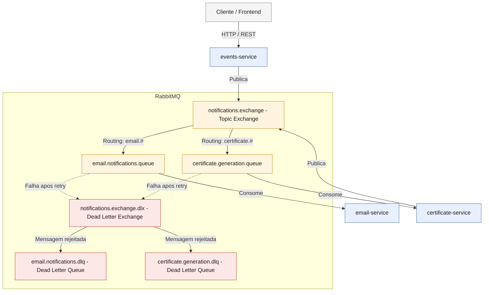

# 📅 Event Platform

Uma plataforma baseada em microsserviços para gerenciamento de eventos, desenvolvida com Java e Spring Boot, com
comunicação assíncrona entre os serviços utilizando RabbitMQ.

---

## ✨ Funcionalidades

- Criação e gerenciamento de eventos
- Inscrição de participantes em eventos
- Validação das regras de negócio para inscrição
- Processamento assíncrono de e-mails para confirmação de inscrição e emissão de certificados
- Geração automática de certificados em PDF para participantes que realizaram check-in após o encerramento do evento
- Download de certificados via API REST
- Documentação com Swagger/OpenAPI
- Testes automatizados, unitários e de integração

---

## 🛠️ Tecnologias utilizadas

- Java 21
- Spring Boot
- Spring Data JPA
- Spring Web MVC
- PostgreSQL (um banco de dados por serviço)
- RabbitMQ
- Maven
- Swagger/OpenAPI
- JUnit 5 + Mockito
- Docker
- Docker Compose

---

## 🏗️ Arquitetura

O projeto adota uma arquitetura de microsserviços com comunicação orientada a eventos. O fluxo de comunicação entre os
serviços acontece de maneira assíncrona utilizando o RabbitMQ para envio e recebimento de mensagens.

### 🧩 Serviços

1. **`events-service`**: Microsserviço responsável por fornecer a API REST para as operações do domínio de eventos. Ao
   processar requisições, ele publica mensagens no RabbitMQ para notificar outros serviços. Também possui um scheduler
   que, ao detectar eventos encerrados, publica solicitações de geração de certificados para os participantes que
   realizaram check-in.
2. **`email-service`**: Microsserviço responsável por consumir as mensagens publicadas pelo events-service no RabbitMQ e
   processar o envio de e-mails de confirmação de inscrição e de notificação de certificado disponível.
3. **`certificate-service`**: Microsserviço responsável por consumir as solicitações de geração de certificado
   publicadas pelo events-service, gerar o certificado em PDF e disponibilizá-lo para download via API REST. Após a
   geração, publica uma notificação no RabbitMQ para que o email-service envie o e-mail ao participante com o link
   para download.

### 📐 Diagrama da arquitetura



---

## 🐳 Como executar

### Pré-requisitos

* Docker
* Docker Compose

### Configuração

O projeto contém arquivos de exemplo para variáveis de ambiente. Nos diretórios de cada serviço, você poderá encontrar
um arquivo de exemplo (`.env-example`).

Copie os arquivos de exemplo para `.env` em suas respectivas pastas e ajuste os valores:

```bash
cp email-service/.env-example email-service/.env
cp events-service/.env-example events-service/.env
cp certificate-service/.env-example certificate-service/.env
```

### Execução

Para iniciar toda a infraestrutura simultaneamente usando o Docker Compose de produção, na raiz do projeto
execute:

```bash
docker compose up --build
```

> O comando criará os bancos de dados PostgreSQL, o RabbitMQ e fará o build das imagens dos microsserviços. Utilize o
`--build` sempre que alterar o código-fonte, o `pom.xml` ou os `Dockerfile`s. Nas demais execuções, utilize apenas
`docker compose up`.

Para utilizar o ambiente de desenvolvimento:

```bash
docker compose -f docker-compose.dev.yml up --build
```

> Utilize `--build` na primeira execução. Depois, utilize apenas `docker compose -f docker-compose.dev.yml up`.

### Acessando os serviços (Ambiente Dev)

- **`events-service`**: `http://localhost:8081`
- **`email-service`**: `http://localhost:8082`
- **`certificate-service`**: `http://localhost:8083`
- **RabbitMQ Management**: `http://localhost:15672`

---

## 📚 Documentação da API (Swagger / OpenAPI)

Com os serviços em execução, acesse a documentação interativa nos seguintes endereços:

- **Events Service**: [http://localhost:8081/swagger-ui/index.html](http://localhost:8081/swagger-ui/index.html)
- **Certificate Service**: [http://localhost:8083/swagger-ui/index.html](http://localhost:8083/swagger-ui/index.html)

---

## 👩‍💻 Autora

Ana Carolina Troiano
